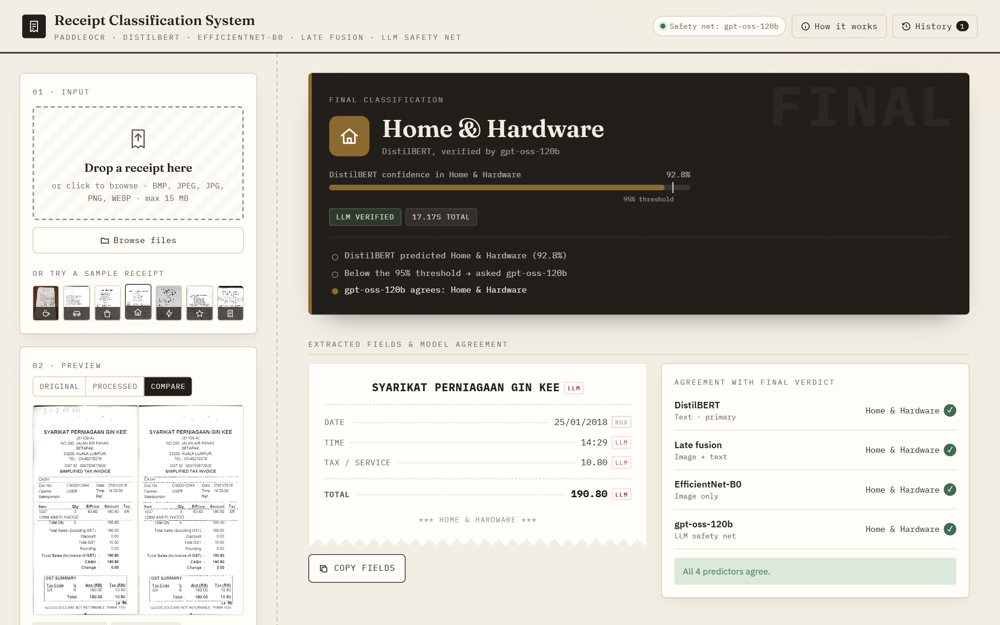
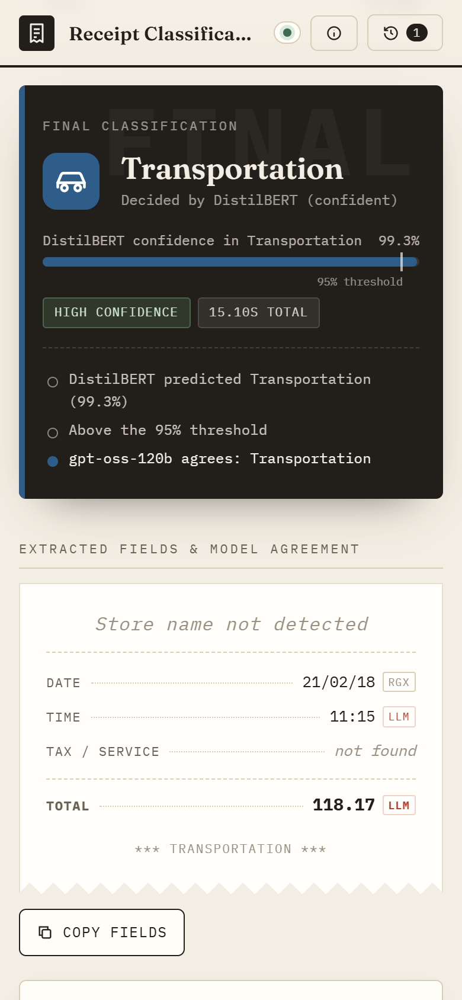

# Receipt Classification System

A Flask web app that turns a photo of a receipt into structured, categorised
spending data, combining OCR, a fine-tuned DistilBERT text classifier, an
EfficientNet-B0 image classifier and an LLM safety net. Built as my Final Year
Project and polished into a live demo.



<p align="center"></p>

It runs the full pipeline in the browser:

```
upload → preprocessing → PaddleOCR → field extraction (regex + LLM)
       → DistilBERT · EfficientNet-B0 · late fusion → LLM safety net → verdict
```

| Stage | What it does |
|---|---|
| **Preprocessing** | Grayscale, resize to 1800px, then a sharpness check picks *scan* (light sharpen) or *photo* (bilateral denoise + adaptive threshold) |
| **OCR** | PaddleOCR 3.x reads the text lines |
| **Field extraction** | Regex first pass for date / time / tax / total; `gpt-oss-120b` (Groq) fixes OCR typos, finds the store name and gives its own category |
| **Classification** | **DistilBERT V1** (OCR text, primary). **EfficientNet-B0 V1** (image) and **late fusion** (0.3 CNN + 0.7 BERT) are shown for comparison |
| **Safety net** | If DistilBERT is below 95% confidence, or the LLM flags an unusual receipt, the LLM's category wins. Images with no receipt text are rejected |

### Validation results (440 held-out receipts, 7 categories)

| Model | Input | Accuracy | Macro F1 |
|---|---|---|---|
| DistilBERT V1 (augmented) | OCR text | 90.45% | 0.865 |
| EfficientNet-B0 V1 (augmented) | Preprocessed image | 86.14% | 0.803 |
| **Late fusion 0.3 / 0.7** | Image + text | **91.14%** | **0.881** |

## Features

- **Live pipeline progress.** Each stage ticks off with its own timing; scans queue when several people use the demo at once.
- **Explained verdict.** Shows the final category, DistilBERT's real confidence against the 95% threshold, and a decision trail explaining why the safety net did or didn't step in.
- **Model agreement panel.** DistilBERT, fusion, CNN and the LLM side by side, with ✓/✗ against the final verdict.
- **Printed-receipt field card.** Each value is tagged with its source (regex or LLM).
- **Image viewer.** Original / processed / side-by-side compare, with click-to-zoom.
- **Seven sample receipts**, one per category, taken from the validation set (never seen in training).
- **Mobile friendly.** "Take photo" camera button and a sticky scan button.
- **Scan history** stored in the browser, **JSON export**, copy fields or OCR text, and paste an image from the clipboard.
- **"How it works" panel** with the metrics above and per-category F1.

## Setup

Requires Python 3.10+.

```bash
git clone https://github.com/wenkeeeeeeee/receipt-classification-system.git
cd receipt-classification-system
pip install -r requirements.txt
python download_models.py      # ~260 MB of trained weights from the v1.0 release
```

`download_models.py` fetches
[`receipt-models-v1.zip`](https://github.com/wenkeeeeeeee/receipt-classification-system/releases/tag/v1.0)
into `./models`:

```
models/CNN_aug/best_efficientnet.pth      models/CNN_aug/class_names.json
models/BERT_aug/best_distilbert/          models/BERT_aug/label_mapping.json
```

Set `MODELS_DIR` to load them from somewhere else.

For the LLM features, copy `.env.example` to `.env` (here or in the project
root) and set `GROQ_API_KEY`. **Without a key the demo still works:** you get
regex fields plus DistilBERT only, the UI shows "Safety net off", and nothing
gets mislabelled.

```bash
python app.py          # http://127.0.0.1:5000
```

The terminal also prints a LAN URL for phones on the same Wi-Fi. For a public
link, run `start_tunnel.bat` in a second terminal. This needs `cloudflared.exe`
in this folder, from https://github.com/cloudflare/cloudflared/releases. It
needs no account and prints a `https://….trycloudflare.com` URL.

CLI sanity check without the web UI:

```bash
python inference.py path\to\receipt.jpg
```

## Engineering notes: what was fixed and why

This version replaces the earlier `demo1` / `demo2` / `democloud` prototypes.
The pipeline concept is unchanged; these are correctness fixes:

1. **An LLM failure no longer means "not a receipt".** Before, any Groq error
   (timeout, rate limit, missing key) returned `{}`. The empty category then
   triggered the blank-receipt rule, so valid receipts came out as *"Blank / Not
   a Receipt"* with 100% confidence. The LLM status is now explicit
   (`ok` / `error` / `disabled`), and on failure the system falls back to
   DistilBERT.
2. **The LLM token budget was too small.** `gpt-oss-120b` is a reasoning model,
   and `max_tokens` covers its hidden reasoning too. At 800, longer receipts ran
   out of tokens before any JSON was written (`json_validate_failed`, empty
   output). In testing this hit 3 of 7 receipts. The budget is now 4096 with one
   retry.
3. **The CNN gets the same kind of image it was trained on.** `Datasets/split`
   holds the *preprocessed grayscale* images, but the old demo fed the CNN the raw
   colour photo. It now gets the preprocessed image, saved as JPEG like the
   training set. On the sample receipts EfficientNet now agrees with the correct
   label on most samples, often at ~100%.
4. **BERT `MAX_LEN` matches training.** DistilBERT V1 was fine-tuned with 256
   tokens, but inference used 512.
5. **Fusion uses EfficientNet-B0 V1**, the model the 91.14% fusion result was
   measured with (the old demo loaded V2).
6. **Confidence is never faked.** The old safety net rewrote confidences to
   99.9% / 100% and overwrote the fusion label, so the bars stopped matching. Model
   scores are now untouched, and the decision is reported separately with a
   reason.
7. **Thread safety.** PaddleOCR and torch aren't thread-safe. Scans now run on a
   single worker thread with a queue (limit 8), so simultaneous users through the
   tunnel can't crash the server.
8. **The LLM sees real line breaks.** OCR lines used to be space-joined, so the
   "first 12 lines" header was really the whole receipt. The LLM now gets the
   lines; DistilBERT still gets the space-joined text it was trained on.
9. **Smaller fixes:**
   - Unicode-safe image I/O with EXIF orientation applied.
   - ASCII-safe upload names and old-upload cleanup (newest 60 files are kept).
   - Uploads checked as real images; JSON error for over-size files.
   - The tax regex no longer matches "Tax Invoice No." / "GST ID", and tax ≥ total is discarded.
   - Thousands separators are parsed (`1,234.56`).
   - The Paddle env flags are set *before* import (faster startup).
   - One shared label map, so "Food and beverages" / "Other" display consistently.

## Files

| File | Purpose |
|---|---|
| `app.py` | Flask server, job queue, pipeline wiring, `/api/*` endpoints |
| `preprocessing.py` | Adaptive scan/photo preprocessing |
| `ocr_processor.py` | PaddleOCR 3.x wrapper |
| `field_extraction.py` | Regex + LLM validator, with explicit LLM status |
| `inference.py` | EfficientNet-B0 + DistilBERT loading, prediction, late fusion |
| `safety_net.py` | Override / rejection rules and the decision trail |
| `labels.py` | Category names and label normalisation |
| `download_models.py` | Fetches the trained weights from the GitHub release |
| `templates/index.html`, `static/app.css`, `static/app.js` | Frontend |
| `static/samples/` | One validation-set receipt per category |

## API

| Endpoint | |
|---|---|
| `POST /api/scan` (multipart `file`) | Queues a scan → `{job_id, position}` |
| `GET /api/jobs/<id>` | `{status, stage, timings, result?}`; poll until `done` / `error` |
| `GET /api/info` | Categories, model card, LLM status, samples |
| `GET /api/health` | Liveness + queue length |

Processing takes about 8–15 s per receipt on a laptop CPU, mostly OCR.
